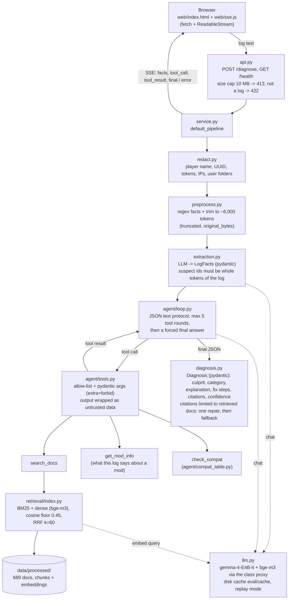
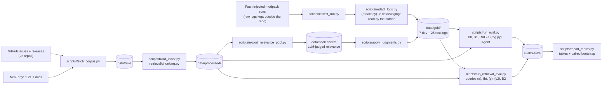

# Architecture

Diagram source for the report (Mermaid; GitHub renders it). Every box names the module that implements it.

## Request path (the app)

The page shows progress events as they arrive. Only structured events are streamed, never raw model tokens. Model
text is inserted with `textContent`.

## Offline: corpus, labels, evaluation

The evaluation scripts call the pipeline functions directly (`preprocess_log`, `extract_facts`, `rag1`, `run_agent`),
not the HTTP API. With `CRASHDOC_REPLAY=1` every LLM and embedding call is served from `eval/cache/`, so the numbers
reproduce without a key.
