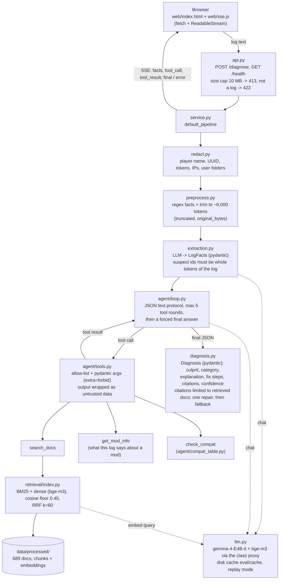

# NeoForge Log Doctor: diagnosing Minecraft mod-loading crashes with retrieval and a tool-using agent

**Course:** KMITL LLM Applications · **Author:** [name, student id] · **Repository:** https://github.com/Watoreee/NeoForge-Log-Doctor

**Provenance.** The code was built with Claude Code from a written plan (not included in the repository), and the
author reviewed it. Every number in this report comes from `eval/results/` and can be rebuilt with
`python scripts/report_tables.py --split test` (no API key needed, see Section 7).

## 1. Problem

Modded Minecraft packs contain hundreds of mods. When one is missing, is the wrong version, or was built for another
loader, the game stops during loading and leaves a crash report and a `latest.log` of several hundred kilobytes to a few
megabytes. The useful information is real but buried: which mod is at fault, what kind of fault it is, and what fixes it.
Players usually paste the log into a forum or Discord and wait.

NeoForge Log Doctor takes a pasted NeoForge 1.21.1 crash report or `latest.log` and returns a structured diagnosis:

- the **culprit mod id**,
- a **category** (`missing_dependency`, `version_mismatch`, `mixin_conflict`, `out_of_memory`, `other`),
- an **explanation** and **fix steps**,
- **citations** to NeoForge documentation and GitHub issues that were actually retrieved, and
- a **confidence** level.

It streams its progress (facts read from the log, each tool call and its result, the final answer) to a small web page.

The question the evaluation asks is narrower than "does it work": **does retrieval, or an agent that decides what to
retrieve, improve diagnosis over the same LLM alone, and does a better retrieval query improve retrieval?**

## 2. System

Figure 1. Request path.



The diagram source is `docs/architecture.md` (Mermaid; one diagram for the request path, one for the offline corpus,
label and evaluation path). The request path is:

1. **API** (`api.py`, FastAPI). `POST /diagnose` accepts up to 10 MB (larger is refused with HTTP 413, empty or
   non-log input with 422) and answers with Server-Sent Events: `facts`, `tool_call`, `tool_result`, `final` or `error`.
   Only structured events are streamed, never raw model tokens. `api.py` only calls `service.py`. It never calls the LLM
   or the retriever directly.
2. **Redaction** (`redact.py`) runs before anything else sees the log: player name, UUIDs, access tokens, IP addresses
   and the OS user folder are replaced by placeholders.
3. **Preprocessing** (`preprocess.py`) detects the format (crash report, `latest.log`, `debug.log`), extracts facts with
   regular expressions (loading errors, dependency lines, exceptions, versions, the mod list) and, for long logs, keeps
   the most informative lines up to about 6,000 Gemma tokens. The `facts` event reports whether the log was trimmed and
   its original size.
4. **Extraction** (`extraction.py`) asks the LLM for a validated `LogFacts` object (exception type, category, suspect mod
   ids, versions). A suspect mod id is kept only if it occurs as a whole token in the log, which removes invented ids.
5. **Agent loop** (`agent/loop.py`), at most 5 tool rounds and then a forced final answer. Three tools are on an
   allow-list (`agent/tools.py`): `search_docs` (hybrid retrieval), `get_mod_info` (what this log says about a mod) and
   `check_compat` (a static NeoForge/Minecraft/Java compatibility table). Tool arguments are pydantic models with
   `extra="forbid"`. An unknown tool or bad arguments come back to the model as an error and are never executed. Tool
   output is wrapped in `<untrusted_data>` delimiters, because retrieved issue text is written by strangers.
6. **Retrieval** (`retrieval/index.py`): BM25 and dense (bge-m3) each return their top chunks, a cosine floor (0.45)
   drops weak candidates, and the two rankings are fused with reciprocal rank fusion (k = 60). The corpus is 689
   documents (NeoForge 1.21.1 docs, GitHub issues and releases of 22 mod repositories), 2,160 chunks.
7. **Diagnosis** (`diagnosis.py`): the final JSON is validated into a pydantic `Diagnosis`. Citations are restricted to
   documents that were retrieved in this request. An invalid reply gets one repair attempt, then a fallback built from
   the regex facts with low confidence.
8. **LLM client** (`llm.py`): `gemma-4-E4B-it` (fixed by the course) and `bge-m3` through the class proxy, temperature 0.
   Every call is cached on disk by a hash of the request. With `CRASHDOC_REPLAY=1`, all calls are served from the
   committed cache, and a cache miss is an error.

### Key design decisions

- **The query is built from extracted fields, not from the log.** Section 5.2 measures this choice.
- **JSON text protocol instead of native tool calling.** On this proxy, with the real prompt, Gemma made 0 native tool
  calls on 7 of 7 dev logs, and `tool_choice="required"` returned an empty call. The agent therefore writes one JSON
  object per turn (`{"action": "tool", ...}` or `{"action": "final", ...}`). The safeguards (allow-list, argument
  models, untrusted-data delimiters, step limit) are the same as for native calls.
- **Validated output everywhere.** Category is an enum, the culprit must be a whole token of the log, and citations must
  be retrieved ids. In the reported runs the fallback was never needed (0/25 test, 0/7 dev).
- **Configuration only from the environment** (`config.py`). `.env` is git-ignored, and `/health` never returns the key
  or the base URL.

## 3. Data

**Logs.** All logs come from fault injection into one modpack (ATMons; NeoForge 21.1.224, Minecraft 1.21.1, Java 21),
collected by the author. Each run disables, downgrades or swaps one mod (for example the Fabric build of Architectury, a
1.20.4 build of YUNG's API, a Create downgrade) or lowers the memory limit, and records the crash report and
`latest.log`. Raw logs are kept outside the repository, redacted with `scripts/redact_logs.py` and read by the author
before they enter `data/gold/`. Of 20 runs, 19 were usable (r07 dropped), and r10 and r11 count as one scenario, which
gives **18 scenarios and 32 labelled logs: 7 dev logs (4 scenarios) and 25 test logs (14 scenarios)**. Splits are by
scenario, so a crash report and the `latest.log` of the same run are never on both sides. `duplicate_mod` and
`config_error` could not be produced (NeoForge 21.1 tolerates identical duplicate jars), so they are not covered.

**Labels.** Each log has a `culprit_mod_id`, a list of `acceptable_culprits` (checked against the log) and a category.
Two labels were corrected after the first test run, both documented with before/after numbers (Section 6).

**Relevance judgments.** For retrieval metrics, the top 5 documents of six retrieval conditions were pooled per scenario
and judged by an LLM (Claude) from each document's title and one excerpt. The author reviewed the unsure ones and
checked 8 documents. A second LLM pass checked 30 more (15 ticked, 15 unticked, seed 42) and agreed with 26/30. All 4
disagreements are ticked documents whose title matches the failure but whose cause differs. The labels were kept as
they are. Seven test logs have no relevant document in the corpus (`none_found`), so they test abstention, not
retrieval.

## 4. Evaluation method

**Conditions.**

| Condition | What it is |
|---|---|
| B1 | One fixed regex rule, never tuned: the first mod under "Suspected Mods", else the mod named in the first loading error, else none. No LLM. |
| B0 | The LLM alone: one call on the preprocessed log, no extraction step and no retrieval. |
| RAG-1 | B0 plus one retrieval with the extracted-field query; the documents go into the diagnosis call. |
| Agent | The full system of Section 2 (tool loop, max 5 steps). |
| B2 | Retrieval baseline: BM25 with the raw log as the query. |

**Metrics.** Culprit accuracy **strict** (prediction equals `culprit_mod_id`) and **lenient** (prediction is in
`acceptable_culprits`); category accuracy; citation validity (cited ids that were retrieved); for retrieval, recall@5,
hit@5 and MRR at document level on the logs that have relevant documents; abstention recall and specificity for the
cosine floor; and groundedness (does the cited excerpt support the explanation).

**Statistics.** Differences are paired, with a 95% interval from a **scenario-level bootstrap** (1,000 resamples, seed
0): logs of one scenario are resampled together, because a crash report and its `latest.log` are not independent.

**Discipline.** Prompts and `min_score` were chosen on dev only. The RAG-1 prompt (`rag1-v1`) was not tuned. The agent
prompt (`agent-v4`) was tuned on dev. Test was run only through `--allow-test`. The HTTP API and the page are tested
(272 unit tests, plus a real-browser check of incremental streaming) but are not part of the measured numbers.

## 5. Results (test split, 25 logs, 14 scenarios)

### 5.1 Diagnosis

| Condition | culprit strict | culprit lenient | category | logs with a citation | citations valid |
|---|---|---|---|---|---|
| B1 (regex) | 7/25 (28%) | 7/25 (28%) | n/a | n/a | n/a |
| B0 (LLM only) | 17/25 (68%) | 19/25 (76%) | 19/25 | n/a | n/a |
| RAG-1 | 18/25 (72%) | 18/25 (72%) | 19/25 | 14/25 | 14/14 |
| Agent | 19/25 (76%) | 20/25 (80%) | 19/25 | 14/25 | 14/15 |

| Paired difference, strict culprit | difference | 95% CI |
|---|---|---|
| B0 minus B1 | +0.400 | [+0.125, +0.720] |
| RAG-1 minus B0 | +0.040 | [+0.000, +0.120] |
| Agent minus B0 | +0.080 | [+0.000, +0.192] |
| Agent minus RAG-1 | +0.040 | [+0.000, +0.120] |

**The LLM clearly beats the regex baseline** (+0.400, interval excludes 0). B1 typically names a mod that *reports* a
missing dependency (r01: `ars_nouveau` for `curios`; r17: `cobblefurnies` for `architectury`) or nothing at all. B1 is
deliberately simple, so this does not show that LLMs beat heuristics in general.

**Retrieval and the agent are not shown to improve diagnosis.** Each of the three intervals touches 0, and one or two
logs decide each difference. Category accuracy is the same (19/25) for all three LLM conditions. The agent searched
about once per log (26 tool calls on 25 logs, and its prompt requires one search), so in practice it behaves like RAG-1
with an extra turn. What retrieval adds is citations: 14 of 25 logs carry one.

### 5.2 Retrieval: the measured improvement (query construction)

Document-level retrieval on the 18 test logs (9 scenarios) that have relevant documents, cosine floor 0.45:

| Query | recall@5 | hit@5 | MRR |
|---|---|---|---|
| B2: BM25, raw log | 0.028 | 1/18 | 0.033 |
| (a) hybrid, preprocessed log text | 0.167 | 6/18 | 0.208 |
| **(b) hybrid, extracted fields** (exception type, suspect mod ids, category keywords) | **0.597** | **13/18** | **0.455** |
| BM25 only, (b) | 0.444 | 11/18 | 0.419 |
| dense only, (b) | 0.458 | 12/18 | 0.551 |
| (c) oracle: gold acceptable culprits + gold category + LLM exception | 0.458 | 11/18 | 0.319 |
| (c2) oracle: gold culprit + gold category + regex exception | 0.458 | 11/18 | 0.358 |

**(b) minus (a) = +0.431, 95% CI [+0.222, +0.681]** over 9 scenarios. Building the query from the extracted fields
more than triples recall@5 compared with querying with the log. This is the project's one measured improvement with a
before/after number. It is a retrieval improvement. It did not translate into a significant diagnosis improvement
(5.1). It also depends on the LLM's extraction.

**The oracles are not upper bounds.** (c) and (c2) are both *worse* than (b): -0.139, CI [-0.292, -0.014] and
[-0.292, -0.028]. Gold mod ids are not the words the relevant issues use, and a bare mod id is a weak query. The extracted
query carries the exception type and category words that issue titles contain.

Dev has only 3 logs with relevant documents (2 scenarios), so its retrieval numbers (for example (b) 0.333, (c) 1.000)
are not evidence of anything.

### 5.3 Abstention

The cosine floor was meant to make the system say "nothing relevant" on the `none_found` logs. It never did:
**abstention recall 0/7**, specificity 18/18 (it never abstained wrongly because it never abstained). The maximum
cosine of the `none_found` logs (0.535 to 0.647) lies inside the range of logs that do have relevant documents (0.618
to 0.787), and on dev the `none_found` logs scored *higher*. A similarity floor cannot detect "the corpus has no
answer". At 0.45 the floor removed 126 BM25-only candidates, none of them relevant. The agent cited nothing on the 7
`none_found` logs, but it still diagnosed all 7 with `high` confidence, so this is not abstention. **Confidence is not
calibrated**: the agent said `high` on all 6 of its strict-culprit misses too.

### 5.4 Groundedness

Of the 25 test logs, the agent cited something on 14 (coverage 14/25). Groundedness was judged only on those 14: does
the cited excerpt support the explanation? **This was judged by an LLM (Claude) at the author's request, not by a
human**, from the excerpt shown and without opening the URLs. It is reported as an LLM judgment.

| | value |
|---|---|
| Citation coverage | 14/25 logs |
| Grounded, among logs with a citation | **5/14**, of which 3 only in part; fully supported 2/14 |

Fully supported: r08 (both logs), where the cited issue says a mod requires Create 6.0.1 while 6.0.0 is installed. In
part: r03 (both logs; the issue supports "install Architectury" but not the rctapi half) and r05_latest (supports the
kotlinforforge half). The other 9 cite an issue about a *different* failure of the same mod (r01, r16, r17, r09_crash)
or an unrelated one. **Citation validity (14/15) is therefore not evidence of support**: the citations are on-topic by
mod name, not by cause.

## 6. Failure analysis

The agent's 11 misses on test fall into four patterns. B0 and RAG-1 show the same patterns.

1. **Right mod, wrong category.** r16 (YUNG's API swapped for a 1.20.4 build) and r17 (Architectury swapped for the
   Fabric build), both logs each: the culprit is right, but the category is `missing_dependency` instead of
   `version_mismatch`. NeoForge skips the wrong jar silently and the dependants report the mod as "not installed", so
   the log really does look like a missing dependency. Four of the agent's six category misses are these. The page's
   **Known failure** example (a Fabric build of Cobblemon) shows the same error live.
2. **Blaming the mod that reports.** r05 (Kotlin for Forge disabled): the agent names `cobblemon`, the most visible mod
   that fails to load. r03 (Architectury disabled): it names `rctapi` or nothing. r09_latest (Trash Cans swapped for a
   Minecraft 26.x build): it names `supermartijn642corelib`, because the log's error line is about the corelib version.
   This is the same error the regex baseline makes, at a lower rate.
3. **Confident answers without a corpus.** r04 (`simpletms`, a `ClassNotFoundException`, no tracker in the corpus): on
   `latest.log` the agent says `dragomordor` with `high` confidence and no citation. Nothing in the system knows that
   the corpus cannot answer.
4. **Label choice.** r14 was relabelled from `mixin_conflict` to `other` after the first test run (the log shows one
   plugin crashing on a missing mod, not two mixins conflicting). All three LLM conditions still say `mixin_conflict`
   with the correct culprit, so this miss reflects the label as much as the model.

**Retrieval misses.** (b) has recall@5 = 0 on 5 of 18 logs, and all five are crash reports (r03, r08, r09, r17, r19)
whose `latest.log` twins score higher (0.50 to 1.00). The cause was not investigated.

**Label corrections after the first test run.** (i) r04: `cloth_config` was removed from the acceptable culprits (the log
shows it loaded); no number changed. (ii) r14: `mixin_conflict` became `other`. B0, RAG-1 and the agent each went from
20/25 to 19/25 on category, and no culprit or retrieval number changed. Retrieval, B0 and B1 therefore ran three times on
test, and RAG-1 and the agent twice. The reported numbers are from the last run: label-corrected, not tuned.

## 7. Reproducibility

The corpus index (`data/processed/`) and the LLM and embedding cache (`eval/cache/`) are committed. On a clean clone,
without an API key:

```bash
pip install -r requirements.txt && pip install -e .
export CRASHDOC_REPLAY=1          # PowerShell: $env:CRASHDOC_REPLAY = "1"
python scripts/run_eval.py --split test --allow-test --conditions B0,B1,RAG1,FULL
python scripts/run_retrieval_eval.py --split test --allow-test --min-score 0.45
python scripts/report_tables.py --split test
pytest -q
```

This was checked on a fresh clone in a new virtual environment: the tables above reproduced exactly. One provenance
caveat: the result files record git `25417e4`, but the r14 relabel was not yet committed when they were written. The
fresh-clone re-run on the committed tree gave identical numbers.

## 8. Limitations

- **One modpack, one author, small sample.** 18 scenarios and 25 test logs. A difference of one or two logs is noise,
  and the dev set (7 logs, 4 scenarios) is too thin to support the choices made on it: every dev bootstrap interval
  collapses to a point.
- **The corpus was extended after the logs were collected** (7 repositories added for the broken mods, before any
  judgment or test result). Five culprits still have no tracker in the corpus. Cobblemon's tracker is on GitLab, which
  the fetcher does not cover. Issue threads are truncated (3,000 characters per post, 12 comments).
- **Relevance labels and groundedness were judged by LLMs.** The author checked 8 relevance documents. The remaining
  checks are LLM judgments and inherit their errors. Pooling (top 5 of six conditions) biases recall upward for the
  pooled conditions.
- **No working abstention and uncalibrated confidence** (5.3). The system always answers.
- **`mixin_conflict` is not evaluated**, since its only scenario was relabelled. `duplicate_mod`, `config_error`,
  Java-version and native (GPU, `hs_err`) crashes are not covered.
- **Truncation.** Only about 6,000 tokens of a long log reach the model. The cost of trimming was not measured
  separately (gold logs up to 1.8 MB went through the same trimming).
- **Privacy.** Player-name redaction covers names the redactor captures or is given. The redactor would change 0 of the
  committed log files, but this is a check of known patterns, not a guarantee.
- **Not done:** a rule-based citation gate (cut), a chunking experiment, a tool-call panel on the page.

## 9. Conclusion

An LLM pipeline with validated structured output diagnoses fault-injected NeoForge crashes much better than a regex
heuristic (68% vs 28% strict culprit accuracy; +0.400, CI [+0.125, +0.720]). Building the retrieval query from
extracted fields instead of the log text is the clearest improvement measured: recall@5 0.167 to 0.597 (+0.431, CI
[+0.222, +0.681]). That retrieval gain did **not** produce a measurable diagnosis gain. RAG-1 and the agent are
statistically indistinguishable from the LLM alone, and their citations support the explanation in only 5 of 14 cases,
as judged by an LLM. The errors that remain are systematic, not random: a wrong-version jar looks like a missing one,
and the mod that complains gets blamed. The evident next steps are a parser-level rule for silently skipped jars, an
abstention signal that is not a similarity threshold, and a larger, multi-pack test set judged by humans.
